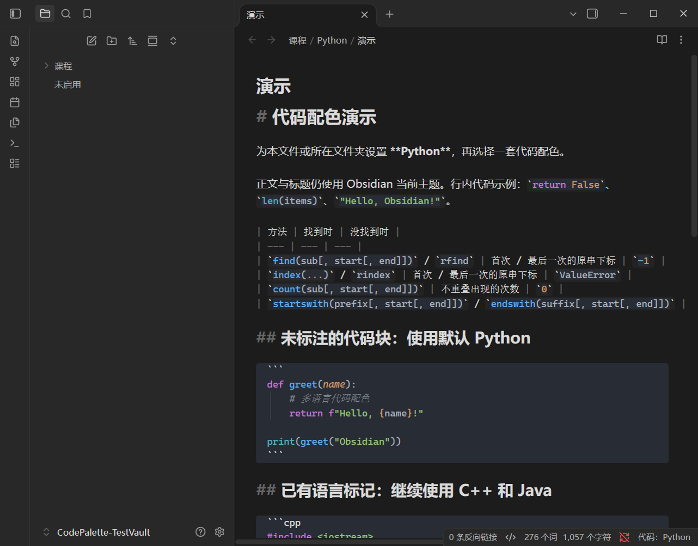

# 🎨 Code Palette

[简体中文](README.md) · [English](README.EN.md)

An Obsidian plugin for independent code color themes, optional file/folder language rules, and a vault-wide palette mode without language inference.

## 📦 Install or update

Download `code-palette-v0.1.2.zip` from the [release page](https://github.com/Tillerion/obsidian-code-palette/releases/tag/v0.1.2). Extract its `code-palette` folder into your vault's `.obsidian/plugins/` directory, then enable **Code Palette** in Community plugins.

For an update, disable the plugin, replace main.js, manifest.json and styles.css, keep your existing data.json, and enable it again.

## 🎛️ Global palette without language inference

Open the plugin settings and enable **全局代码配色（不匹配语言）**. This option is disabled by default to preserve existing configurations.

- Explicit fence labels, such as `java`, `cpp` and `python`, retain their supported language grammar while using the selected code theme.
- Inline code and unlabelled fences receive the theme's plain foreground/background colors. The plugin does not guess their language or assign a language from saved rules.
- Unsupported labels receive plain theme colors in this mode.
- Mermaid, Dataview and other recognized functional blocks retain their own handling.
- Saved file, folder and vault-default language rules are temporarily bypassed. Disabling global mode restores them without deleting settings.
- The master switch and background preferences still apply. Note contents remain unchanged.

## 🗂️ Optional language rules

With global mode disabled, right-click a Markdown file or folder and choose **代码配色：设置语言规则**. Select a default language for inline code and unlabelled fences. Explicit fence labels take precedence.

Rules resolve in this order: file → nearest matching folder → parent folders → vault default. Folder rules can include subfolders. A disabled rule restores native display; removing it restores inheritance.

## 🌗 Languages and themes

The offline bundle includes 24 common languages, including Python, C/C++, Java, C#, JavaScript/TypeScript, SQL, Go and Rust. Ten code themes are available: One Dark Pro, VS Code Dark+/Light+, GitHub Dark/Light, Dracula, Nord, Monokai, and Solarized Dark/Light.

Choose a fixed theme or follow Obsidian's light/dark mode. Defaults are One Dark Pro for dark mode and VS Code Light+ for light mode. Themes affect managed code areas only.

## ✅ Verification and limits

Version 0.1.2 passed 30 background automated tests, TypeScript checking and the production build. Tests include real Shiki grammars, reading DOM behavior in jsdom, and CodeMirror 6 integration. A focused static review found no actionable issues.

**No foreground Obsidian tests or screenshots were taken for this update, at the user's request.** The new settings switch and actual application behavior remain for the user to validate. Prior version 0.1.1 was tested on Windows with Obsidian 1.14.5. See [the verification record](docs/verification.md).

Mobile and third-party theme/plugin combinations have not been exhaustively tested. Individual code snippets over 200,000 characters fall back to native display. TextMate highlighting does not provide language-server semantic coloring.

## 🖼️ Historical screenshots

These screenshots were captured during **v0.1.1** acceptance testing. They illustrate existing reading/source views, not frontend validation of v0.1.2 global mode.

## 🛠️ Build

Use Node.js 22 or later. Run `npm ci`, then `npm run check`. `npm run package` generates the installation ZIP in `dist/`.

## License

Plugin code is MIT licensed. Bundled grammars/themes keep their respective licenses; see [THIRD_PARTY_NOTICES.md](THIRD_PARTY_NOTICES.md).
