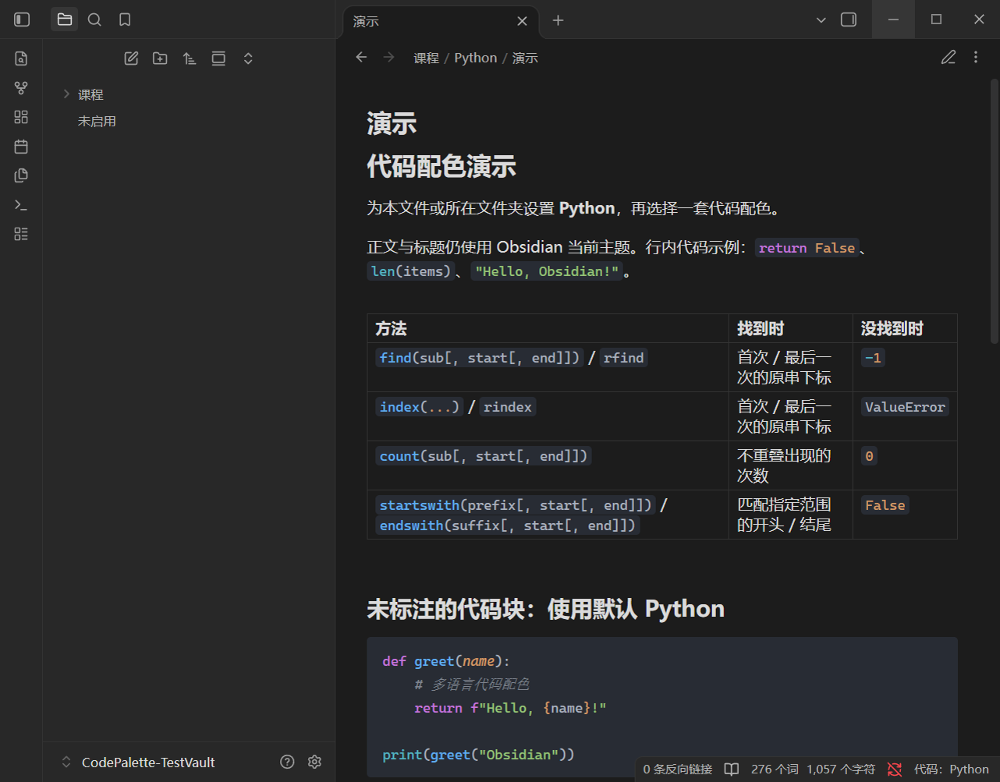

# 🎨 Code Palette

[English](README.EN.md) · [下载 ZIP](https://github.com/Tillerion/obsidian-code-palette/releases/latest) · [社区页面](https://community.obsidian.md/plugins/code-palette)

为 Obsidian 的行内代码、表格代码和代码块选择独立配色。按文件或文件夹设置默认语言，让学习笔记中的短代码也能获得语法高亮，笔记原文保持不变。

**English:** Code Palette brings independent code themes to inline code, tables and code blocks in Obsidian. Set a language for a file or folder, choosing to preserve existing code-block labels or override them for highlighting. A separate global palette works without language guessing. It includes 24 languages and 10 offline themes, supports reading and editing views, and keeps Markdown content unchanged. See the [English guide](README.EN.md) for installation and usage.

## ✨ 功能

- **范围规则：** 按文件、文件夹及子文件夹设置默认语言，也可设置仓库默认规则。
- **多语言高亮：** 内置 Python、C/C++、Java、JavaScript/TypeScript、SQL 等 24 种常用语言，支持保留已有代码块语言或按规则替换高亮语言。
- **独立配色：** 10 套离线主题，包括 One Dark Pro、VS Code Dark+/Light+、GitHub、Dracula、Nord 等；可固定配色或跟随明暗模式。
- **Markdown 正文：** 将规则语言设为 Markdown 并选择替换，可让 `text` 块显示为标题、列表、表格等正文，而不只是代码着色。
- **全局代码配色：** 为未匹配语言规则的笔记统一代码外观，不覆盖已有规则；无标记代码使用基础文字色与背景色，不猜测语言。
- **阅读与编辑：** 支持阅读、实时预览和源码模式；只调整代码区域，正文与 Markdown 内容不变。
- **稳定编辑：** 连续输入时保留已有颜色，新高亮计算完成后统一更新；增量解析和代码块缓存减少重复工作。

## 📦 安装与更新

### ZIP 安装

1. 从 [最新发布](https://github.com/Tillerion/obsidian-code-palette/releases/latest) 下载 ZIP 安装包，**不要下载 GitHub 自动生成的 Source code ZIP**。
2. 解压，将 `code-palette` 文件夹放入笔记仓库的 `.obsidian/plugins/`。
3. 在 Obsidian → 设置 → 第三方插件中启用 **Code Palette**。

```text
你的笔记仓库/
└─ .obsidian/plugins/code-palette/
   ├─ main.js
   ├─ manifest.json
   └─ styles.css
```

**已有版本更新：** 暂停插件，将 ZIP 中的 `main.js`、`manifest.json`、`styles.css` 覆盖到原目录，再重新启用。保留现有 `data.json`，即可保留语言规则和配色设置。升级到 0.2.0 后，原有规则默认继续保留已有语言。

### 插件市场

在 Obsidian → 设置 → 第三方插件 → 浏览中搜索 **Code Palette**。已被应用内目录收录后，可使用“检查更新”升级。

新插件在社区网站通过审核后，同步到应用内目录可能需要最多 24 小时；如暂时搜不到或检查不到更新，请先使用 ZIP 安装。参见 [Obsidian 官方说明](https://obsidian.md/blog/future-of-plugins/#how-do-i-submit-a-new-plugin-or-theme)。

## 🚀 使用

**按语言高亮：** 右键文件或文件夹 → **代码配色：设置语言规则** → 选择 Python、C++、Java 等默认语言。行内代码和无语言标记的普通代码块使用该语言。优先级为：文件 → 最近的文件夹 → 上级文件夹 → 仓库默认 → 未匹配时的全局配色。

**保留或替换已有语言：** 在“已有代码块语言”中选择“保留已有语言（默认）”或“替换为指定语言”。文件、文件夹及仓库默认规则均支持。

**将 text 块渲染为 Markdown 正文：** 把默认语言设为 **Markdown**，再选择“替换为指定语言”，并在插件设置中启用独立的“Markdown 正文预览”。阅读视图和实时预览会显示标题、列表、表格等正文。双击进入原文编辑后，该块保持编辑状态，光标移出也不会恢复预览；点击块末尾的“完成编辑”，或运行“完成 Markdown 编辑并恢复正文预览”命令后恢复正文。输入法组合期间先完成输入，再恢复预览。源码模式始终保留可编辑的围栏原文。

关闭“Markdown 正文预览”后，Markdown 替换规则仍可用于语法高亮。升级到 0.3.0 时该开关默认开启，保留已有正文预览效果。

替换模式会对该范围内所有普通代码块使用规则指定的语言，不只针对 `text`。它只改变显示，原始围栏标签和代码内容保持不变。可直接试用[替换语言示例](examples/替换已有语言.md)。

**只统一配色：** 打开 **全局代码配色（不匹配语言）**。已有语言规则继续生效，包括替换策略、代码类型开关和显式关闭的范围。仅未匹配规则的笔记使用全局配色：已有语言标记的块保留语法高亮，行内代码和无标记块使用基础文字色与背景色。

**选择主题：** 在插件设置中调整固定配色、深浅模式和代码背景。总开关可随时暂停显示效果，设置仍会保留。

## 🖼️ 效果示例

阅读视图示例（截图来自 v0.1.1）：



## 使用说明

- 要求 Obsidian 1.8.0 或更新版本；移动端尚未完成实测。
- Mermaid、Dataview 等已知专用功能块保持原处理。`text` 等纯文本标记默认保持纯文本，启用替换模式后可按规则语言显示。
- 提供语法高亮，不提供代码执行或语言服务器语义着色；普通标识符不一定呈现多种颜色。
- 单段代码超过 200,000 字符时保留原生显示。

## 许可与反馈

[MIT](LICENSE) · [第三方资源许可](THIRD_PARTY_NOTICES.md) · [问题反馈](https://github.com/Tillerion/obsidian-code-palette/issues)
